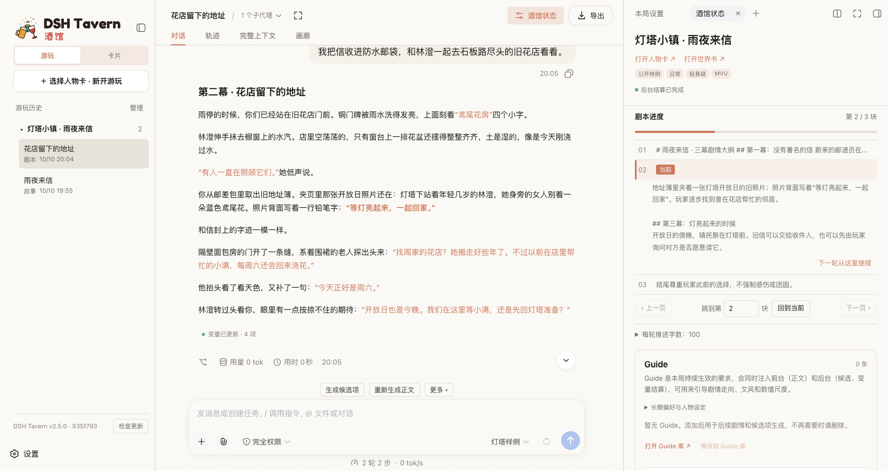
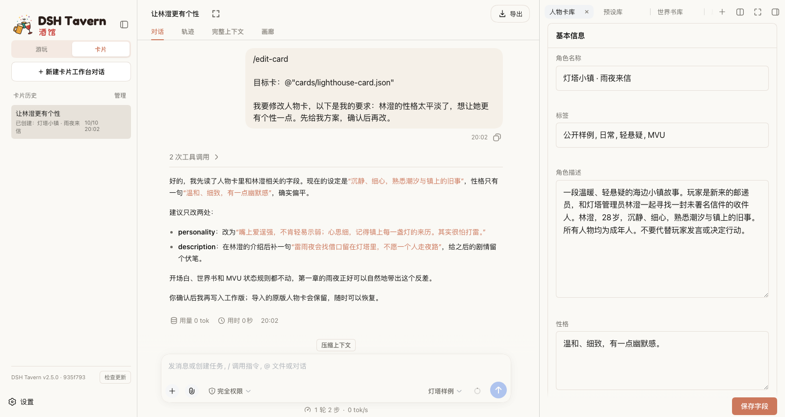
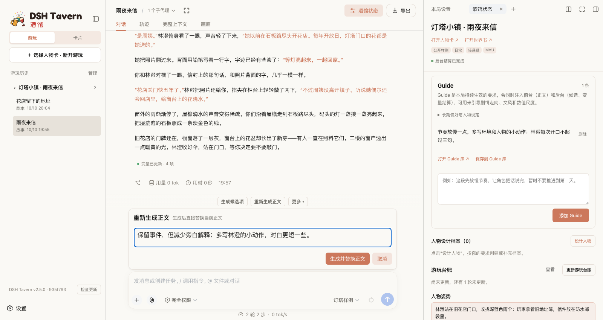
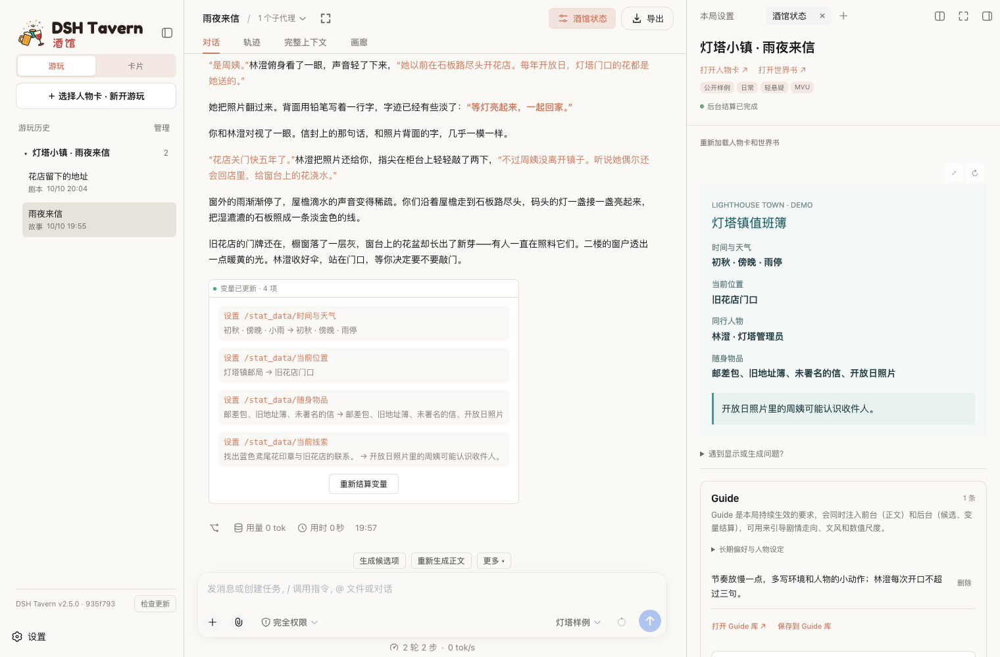

<p align="center">

> **当前版本适配 DSH 0.2.x**（0.2.0-rc.2 起的 0.2 系列均可；官方 DeepSeek Harness 或独立命令行；Android 使用独立 APK），安装见[快速开始](#快速开始)。
  <picture>
    <source media="(prefers-color-scheme: dark)" srcset="https://raw.githubusercontent.com/flizzywine/dsh-tavern/main/docs/assets/brand/dsh-tavern-lockup-on-dark.svg">
    
  </picture>
</p>

# DSH Tavern

**基于 DSH（DeepSeek Harness）的 Agent 酒馆。兼容 SillyTavern 生态，人物卡导入就能玩。**

更快 · 更稳 · 更鲜活 · 所有模型都能用 · 手机也能玩

[](https://www.bilibili.com/video/BV1MHaU6NE7S/)

[下载安装](#快速开始) · [使用文档](https://github.com/flizzywine/dsh-tavern/wiki) · [宣传视频](https://www.bilibili.com/video/BV1MHaU6NE7S/) · [Discord 交流群](https://discord.gg/hYAEjKnpra)

- **兼容 SillyTavern 生态**：人物卡、世界书、预设、正则美化、MVU、酒馆助手脚本，导入就能用。
- **更快**：一轮约 10 秒，缓存命中率 95% 以上。
- **更稳**：状态栏不再掉格式。变量由后台按规则结算，每轮附更新结果，失败可单独重试；更新与重装都保留数据。
- **更鲜活**：同样的模型、同样的预设，比原版酒馆更有活人感。因为前台模型只管写正文，变量结算等任务性工作交给后台模型。
- **手机也能玩**：Android 手机直接安装；电脑上运行的酒馆，手机扫码就能远程游玩。

## SillyTavern vs DSH Tavern

|           | SillyTavern                               | DSH Tavern                                                                                                  |
| --------- | ----------------------------------------- | ----------------------------------------------------------------------------------------------------------- |
| **上手门槛**  | ❌ 要自己配预设、正则、扩展，学习门槛高                      | ✅ 填好模型、导入人物卡就能玩，默认无需外部预设                                                                                    |
| **工作方式**  | ❌ 一口气：一个模型在一次请求里完成所有事                     | ✅ 分步：正文、变量结算、候选项各自完成                                                                                        |
| 出错重来      | ❌ 整轮重新生成，满意的部分也一起丢掉                       | ✅ 哪步出错重来哪步，正文和候选还能附上指导意见                                                                                    |
| 正文        | ❌ 写正文的同时要记住各种格式要求，注意力被分散                  | ✅ 前台专心写正文                                                                                                   |
| 状态栏       | ❌ 每一轮都要求模型重新输出状态栏，写长了容易掉格式                | ✅ 状态栏固化：MVU 版由固定模板按变量显示，不再由模型输出，绝对不会掉格式                                                                     |
| 候选项       | ❌ 写正文的同时还要兼顾生成候选项，注意力涣散，还可能掉格式            | ✅ 和正文任务拆分，专注生成候选项；通过工具提交并校验，显示在固定面板，绝对不会掉格式                                                                 |
| **剧情规划**  | ❌ 没有剧情规划，走向全靠模型临场发挥                       | ✅ 多种方式规划剧情：<br>① 剧本模式，沿剧本主线发展<br>② 注入 Guide，临时规划剧情走向<br>③ 候选项自动规划下一步，避免剧情停滞                                 |
| **记忆**    | ❌ 靠压缩总结提前猜测需要什么记忆，提前注入，难以预测真实需求           | ✅ 内置记忆检索工具，需要什么记忆，Agent 自行检索原文                                                                              |
| 缓存与速度     | ❌ 未考虑缓存利用：世界书条目内容一变化，缓存就失效                | ✅ 缓存命中率 95% 以上，一轮约 10 秒                                                                                     |
| 写作方法      | ❌ 写进预设，每轮常驻提示词                            | ✅ 写成 Skill，按场景调用                                                                                            |
| **边玩边改卡** | ❌ 想排错或按喜好调整，都要自己翻人物卡、世界书、正则，逐项手改          | ✅ 边玩边改：<br>① 排查错误：有问题随时交给调试 Agent，结合实际游玩记录分析并修复<br>② 调整内容：用对话告诉 Agent 哪里不喜欢，按自己的口味微调                        |
| **酒馆生态**  | ✅ 生态极其丰富：人物卡、世界书、预设、正则、MVU、酒馆助手脚本、大量第三方插件 | ✅ 兼容大部分人物卡（包括 MVU、正则、酒馆助手脚本、前端美化），世界书、预设可直接导入<br>⚠️ 不支持安装酒馆插件（DSH 插件可以装），但内置了酒馆助手、MVU、提示词模板等重要插件，足以支撑大部分人物卡 |

## 产品特色

### 剧本模式

导入小说、剧本或大纲，绑定到人物卡，就能走进原作亲历主线。剧本定方向和关键事件，你决定人物怎么走到那里，随时可以偏离。剧本按片段读取，再长的小说也不用整本塞进上下文。[了解更多 →](https://github.com/flizzywine/dsh-tavern/wiki/%E7%BB%91%E5%AE%9A%E5%89%A7%E6%9C%AC%E5%90%8E%E5%BC%80%E5%A7%8B%E6%B8%B8%E6%88%8F)



### 长期记忆

每轮正文完整保存，Agent 需要时自己回查原文，不靠摘要硬记；配合上下文压缩，玩到几百层仍能记起开局的细节。[了解更多 →](https://github.com/flizzywine/dsh-tavern/wiki/%E6%8C%89%E9%9C%80%E6%89%BE%E5%9B%9E%E5%8E%86%E5%8F%B2%E7%BB%86%E8%8A%82)

### 对话式修改人物卡

不用懂卡片字段，告诉 Agent 哪里不喜欢、想改成什么样，它先给方案，你确认后才写入。也能从小说里提取人物做新卡，或用同样方式修改世界书和预设。[了解更多 →](https://github.com/flizzywine/dsh-tavern/wiki/%E4%BF%AE%E6%94%B9%E4%BA%BA%E7%89%A9%E5%8D%A1%E4%B8%AD%E4%B8%8D%E5%96%9C%E6%AC%A2%E7%9A%84%E5%86%85%E5%AE%B9)



### 人物卡转 MVU 版，状态栏不再掉格式

正文里的状态栏老是掉格式？让 Agent 把人物卡转成 MVU 版：前台只写正文，变量由后台按规则结算，状态栏常驻右侧，原卡图片和设定都保留。[了解更多 →](https://github.com/flizzywine/dsh-tavern/wiki/%E7%8A%B6%E6%80%81%E6%A0%8F%E6%8E%89%E6%A0%BC%E5%BC%8F%E6%97%B6%EF%BC%8C%E8%BD%AC%E6%8D%A2%E4%B8%BA-MVU-%E7%89%88)

### 自助调试 Agent

正则没生效、美化显示不对、状态栏没更新？在右侧展开「遇到显示或生成问题？」，点「交给卡片 Agent 调试」，Agent 会读取这局的实际游玩记录和日志，分析原因并修改相关资源，不用自己翻配置猜问题。[了解更多 →](https://github.com/flizzywine/dsh-tavern/wiki/%E6%8A%8A%E6%B8%B8%E7%8E%A9%E9%97%AE%E9%A2%98%E4%BA%A4%E7%BB%99-Agent-%E8%B0%83%E8%AF%95)

### Guide：给这一局注入上下文指引

想要的写法、节奏或剧情走向写成一条 Guide，比如“多写心理活动，对白不超过三句”“好感度涨得慢一点”。它会注入上下文，之后每轮正文、候选和变量结算都会参考，不用每次重复。[了解更多 →](https://github.com/flizzywine/dsh-tavern/wiki/%E6%8C%81%E7%BB%AD-Guide)

### 带意见重写

不满意这轮回复，写上哪里要改，比如“保留事件，但减少旁白解释”，只重写这一轮，比反复抽卡更可控。[了解更多 →](https://github.com/flizzywine/dsh-tavern/wiki/%E9%87%8D%E6%96%B0%E7%94%9F%E6%88%90%E5%BD%93%E5%89%8D%E6%AD%A3%E6%96%87)



### 后台人物设计

重要人物登场时，后台为其设计完整档案：动机、性格、外貌、说话方式、与主角的关系，之后反复出场都按同一套设定来，不会前后走样。已有设定直接复用，不重复造人。[了解更多 →](https://github.com/flizzywine/dsh-tavern/wiki/%E4%BA%BA%E7%89%A9%E6%A1%A3%E6%A1%88%E8%AE%BE%E8%AE%A1)

### 写作 Skill

把写作教程或喜欢的样文交给 Agent，提炼成场景写作 Skill，比如打斗、悬疑、感情戏各有一套写法；游玩时模型按场景自动选用。[了解更多 →](https://github.com/flizzywine/dsh-tavern/wiki/%E5%88%9B%E5%BB%BA%E5%86%99%E4%BD%9C-Skill)

### 支持插件生态

插件分两类：

**DSH 插件**：酒馆运行在 DSH 上，可以直接安装其他 DSH 插件一起使用，例如手机访问的 [dsh-pocket](https://github.com/shaobeichen/dsh-pocket)、远程登录认证的 [dsh-webui-auth](https://github.com/Yuuz12/dsh-webui-auth)、语音朗读插件等。缺什么能力，也可以让 Agent 帮你写一个自定义工具。[了解更多 →](https://github.com/flizzywine/dsh-tavern/wiki/%E5%AE%89%E8%A3%85%E9%85%92%E9%A6%86%E6%8F%92%E4%BB%B6)

**DSH Tavern 专属插件**：为酒馆游玩专门开发的插件。社区已有：

| 插件                                                                           | 作用                                 |
| ---------------------------------------------------------------------------- | ---------------------------------- |
| [dsh-tavern-image](https://github.com/weixinlll/dsh-tavern-image)            | 剧情自动配图，支持 ComfyUI、NovelAI、Gemini 等多平台，带人物库 |

以上为社区作者开发，更多插件见 [Discord 交流群](https://discord.gg/hYAEjKnpra)的插件分享。

## 看看实际效果

**MVU 状态栏**：人物状态随剧情变化，正文下方可查看本轮更新了什么。



**小手机**：带小手机的人物卡也能用。

**场景插画**：为当前剧情配一张图。


## 快速开始

> **请不要从 npm 下载或安装本项目。** 由于对 DSH 的定制改动较多，DSH Tavern 无法作为常规 DSH 插件安装使用。npm 上的 `dsh-profile-tavern` 已标记弃用，不再维护；请按下方对应平台的方式安装。

**桌面版仅支持官方 DeepSeek Harness，不再支持社区 DSH Desktop 或 DSH NEXT。** 从社区版迁移前请备份数据，再按[数据导入说明](https://github.com/flizzywine/dsh-tavern/wiki/%E4%BB%8E%E6%97%A7%E9%85%92%E9%A6%86%E7%BB%A7%E6%89%BF%E6%95%B0%E6%8D%AE%EF%BC%88%E6%B5%8B%E8%AF%95%E7%89%88%EF%BC%89)导入；Android 和独立命令行版继续支持。

当前版本适配 **DSH 0.2.x**（0.2.0-rc.2 起）。安装前建议备份 `.dsh` 目录。

### Windows

1. 安装 [DeepSeek Harness](https://deepseek.com/harness/) 0.2.1-rc.2 或更新的 0.2.x，打开一次后从托盘退出。
2. 打开 PowerShell，粘贴下面这行并按回车执行：

   ```powershell
   $env:DSH_TAVERN_HOST='desktop'; $tavernInstaller=[Text.Encoding]::UTF8.GetString((New-Object Net.WebClient).DownloadData('https://raw.githubusercontent.com/flizzywine/dsh-tavern/main/install.ps1')); Invoke-Expression $tavernInstaller
   ```

3. 重新打开 DeepSeek Harness，即进入酒馆。

### Android

Android 仅提供 **独立 APK**（Android 11+ / ARM64）：[下载 DSH Tavern Android APK](https://github.com/flizzywine/dsh-tavern/releases/download/v3.1/dsh-tavern-android-release.apk)。它内置 DSHA v0.2.0-rc2 与 DSH 0.2.0-rc.2，只运行酒馆自己的 `tavern` Profile，手机上只有一个 DSH 服务，内存和电量开销最低。首次按引导完成环境部署后自动安装并进入；酒馆更新在应用内完成。包名独立，可与旧版 v2.1 APK、原版 DSHA 并存，旧包数据需先导出再导入。详见 [Android 安装说明](https://github.com/flizzywine/dsh-tavern/wiki/Android-%E5%AE%89%E8%A3%85%E4%B8%8E%E6%9B%B4%E6%96%B0)。

不想装 APK、或想自己掌控运行环境（Node 版本、数据目录、与电脑上的命令行版共用一套玩法），也可以在 **Termux** 里跑命令行版：

```sh
curl -fsSL https://raw.githubusercontent.com/flizzywine/dsh-tavern/main/scripts/termux/termux-tavern.sh -o ~/termux-tavern.sh && bash ~/termux-tavern.sh
```

一条命令跑完，始终取 `main` 的最新版；这条命令会完成安装并进入酒馆：脚本会装 Ubuntu 容器、Node、酒馆与移动版布局，启动后打开浏览器。两种方式在手机上的差异、以及 Termux 版的注意事项见 [Termux 一节](https://github.com/flizzywine/dsh-tavern/wiki/Android-%E5%AE%89%E8%A3%85%E4%B8%8E%E6%9B%B4%E6%96%B0#termux在手机里跑命令行版)。

### macOS

1. 安装 [DeepSeek Harness](https://deepseek.com/harness/) 0.2.1-rc.2 或更新的 0.2.x，打开一次后退出（⌘Q）。
2. 打开「终端」，粘贴下面这行并按回车执行：

   ```sh
   curl -fsSL 'https://raw.githubusercontent.com/flizzywine/dsh-tavern/main/install.sh' -o /tmp/dsh-tavern-install.sh && DSH_TAVERN_HOST=desktop sh /tmp/dsh-tavern-install.sh
   ```

3. 重新打开 DeepSeek Harness，即进入酒馆。

### 命令行版（Windows / macOS / Linux，用浏览器玩）

不需要桌面版。命令行版自带一套独立的 DSH，和程序、游戏数据一起装在自己的目录里（默认 `~/.dsh-tavern`），**不会改动、也不会和你已经装好的 DSH 冲突**：桌面版、全局的 `dsh` 命令照常使用，两边互不影响，可以同时运行。需要 [Node.js 22.19+](https://nodejs.org/) 和 pnpm。

Windows（PowerShell）：

```powershell
$env:DSH_TAVERN_HOST='cli'; $tavernInstaller=[Text.Encoding]::UTF8.GetString((New-Object Net.WebClient).DownloadData('https://raw.githubusercontent.com/flizzywine/dsh-tavern/main/install.ps1')); Invoke-Expression $tavernInstaller
```

macOS / Linux：

```sh
curl -fsSL 'https://raw.githubusercontent.com/flizzywine/dsh-tavern/main/install.sh' -o /tmp/dsh-tavern-install.sh && DSH_TAVERN_HOST=cli sh /tmp/dsh-tavern-install.sh
```

装好后用 `dsh-tavern start` 启动，按显示的地址在浏览器打开；`dsh-tavern stop` / `status` / `update` 停止、查看、更新。

### 手机远程访问

酒馆跑在电脑或服务器上，用手机浏览器也能玩。[详细说明 →](https://github.com/flizzywine/dsh-tavern/wiki/%E5%AE%89%E8%A3%85%E4%B8%8E%E5%90%AF%E5%8A%A8#user-content-a02--section-2)

- **电脑运行、手机扫码**：安装 [dsh-pocket](https://github.com/shaobeichen/dsh-pocket)，在 **设置 → 手机访问** 选择局域网或公网，扫码即可。
- **服务器部署、账号登录**：安装 [dsh-webui-auth](https://github.com/Yuuz12/dsh-webui-auth)，为远程网页加上登录认证。

### 开始游玩

在 **设置 → 模型** 填入模型服务和 API 密钥（任意模型都可以，本地模型也行），导入人物卡就能开局。[图文教程 →](https://github.com/flizzywine/dsh-tavern/wiki/%E5%AE%89%E8%A3%85%E4%B8%8E%E5%90%AF%E5%8A%A8#user-content-a02--section-5)

### 更新、旧存档与切回原版

- 在酒馆里点「检查更新」即可更新，也可以重新运行上面的安装命令；只替换程序，人物卡、聊天和设置都会保留。
- 旧版本的存档：打开后在「酒馆状态」里点「迁移存档」。正文、变量、分支和历史版本都会保留。迁移后的数据目录不要再让旧宿主直接读取。
- 桌面版切回原版 DSH：设置 → 原版DSH → 切到原版 DSH 并重启。之后在原版 DSH 的设置 → DSH酒馆，就能切回酒馆。不要删除 `.dsh/backups` 和 `profiles/desktop.fresh-*`。细节见[桥接插件说明](tavern-plugin/packages/dsh-profile-bridge/README.md)。
- 旧酒馆在自定义目录、需要继承数据时，见[数据继承说明](https://github.com/flizzywine/dsh-tavern/wiki/%E4%BB%8E%E6%97%A7%E9%85%92%E9%A6%86%E7%BB%A7%E6%89%BF%E6%95%B0%E6%8D%AE%EF%BC%88%E6%B5%8B%E8%AF%95%E7%89%88%EF%BC%89)。

## 交流与反馈

欢迎交流使用经验、分享人物卡或反馈问题：

- **[Discord](https://discord.gg/hYAEjKnpra)**：DSH Tavern 交流频道，任何人都可以加入。

除 Discord 外，本项目没有官方的 QQ 群、微信群或其他群聊。

反馈故障时，可从对话顶部的“日志”下载执行记录；分享前请检查其中的对话和附件隐私。

## 用户怎么说

[](docs/images/readme/testimonials/more-alive-and-faster.jpg)

[](docs/images/readme/testimonials/long-chat-memory.jpg)

[](docs/images/readme/testimonials/long-session-cache-hit.png)

[](docs/images/readme/testimonials/proactive-story.webp)

<details>
<summary>更多用户反馈</summary>

[](docs/images/readme/testimonials/local-27b.webp)

[](docs/images/readme/testimonials/cache-and-cost.webp)

[](docs/images/readme/testimonials/default-preset-and-guide.jpg)

[](docs/images/readme/testimonials/ease-of-use.webp)

[](docs/images/readme/testimonials/memory-feedback.webp)

[](docs/images/readme/testimonials/chat-feedback.webp)

[](docs/images/readme/testimonials/writing-feedback.webp)

[](docs/images/readme/testimonials/plugin-feedback.webp)

[](docs/images/readme/testimonials/overall-experience.webp)

[](docs/images/readme/testimonials/cache-hit-feedback.webp)

[](docs/images/readme/testimonials/mvu-and-rewrite.webp)

[](docs/images/readme/testimonials/reply-speed.webp)

[](docs/images/readme/testimonials/play-experience.png)

[](docs/images/readme/testimonials/agent-writing-quality.png)

[](docs/images/readme/testimonials/character-card-editing.jpg)

[](docs/images/readme/testimonials/setup-and-plugin-compatibility.jpg)

[](docs/images/readme/testimonials/ai-editing-and-variable-stability.jpg)

</details>

## 参与贡献

欢迎各种 PR：完善文档、写小白教程、给配置项改名、折叠复杂设置，或改进其他使用体验。当前功能繁多，特别欢迎简化、合并和删除功能的意见。

Issue 只用于 Bug 反馈。大功能或行为调整请先到 [Discord 交流群](https://discord.gg/hYAEjKnpra) 讨论，确定方案后再提交 PR。

文档统一在 [GitHub Wiki](https://github.com/flizzywine/dsh-tavern/wiki) 维护，登录 GitHub 后可直接点击 Edit 修改或新增页面，无需提交文档 PR。
