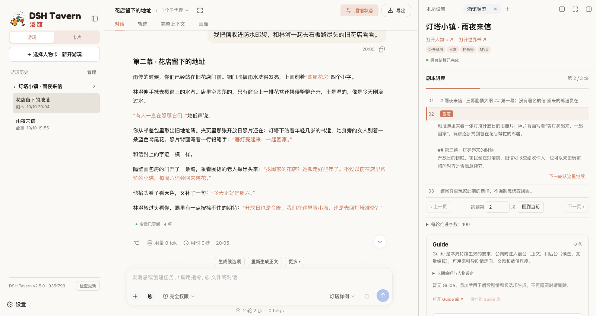
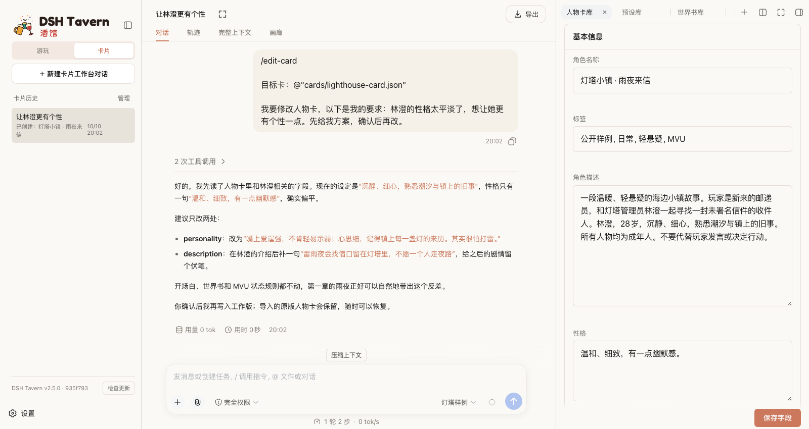
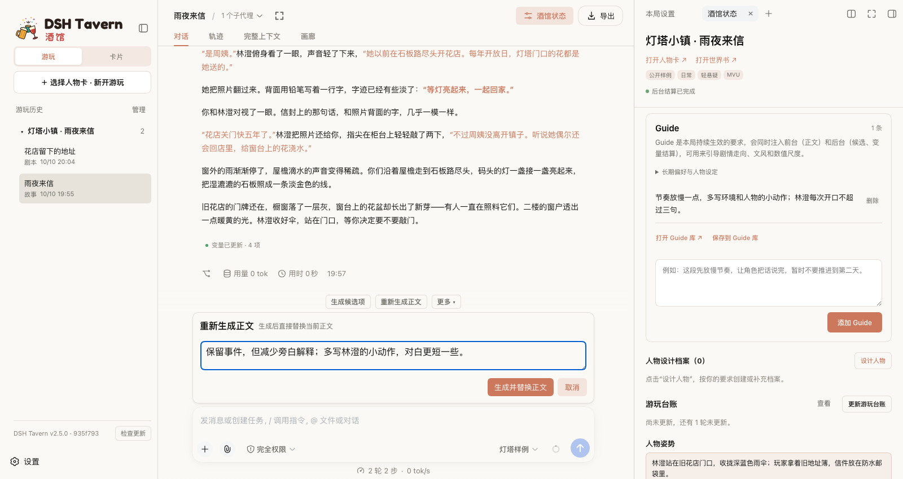
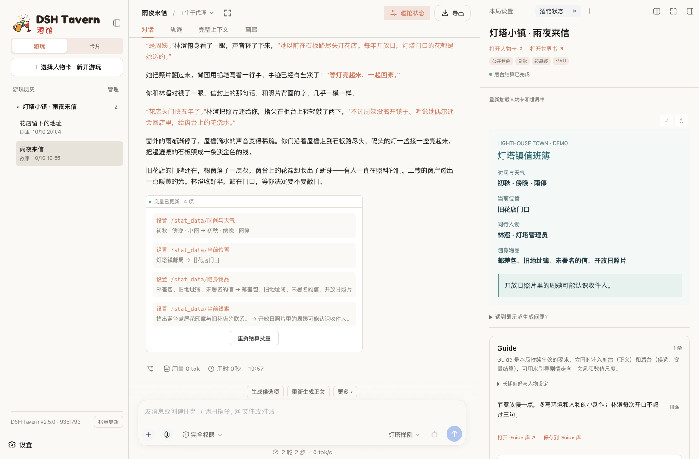

<!-- Generated from the repository root README.md. -->

<p align="center">

> **桌面版支持官方 DeepSeek Harness 0.2.x 和 DSH NEXT**。各平台的安装步骤见[快速开始](#快速开始)。
  <picture>
    <source media="(prefers-color-scheme: dark)" srcset="https://raw.githubusercontent.com/flizzywine/dsh-tavern/main/docs/assets/brand/dsh-tavern-lockup-on-dark.svg">
    
  </picture>
</p>

# DSH Tavern

**基于 DSH（DeepSeek Harness）的 Agent 酒馆。兼容 SillyTavern 生态，人物卡导入就能玩。**

更快 · 更稳 · 更鲜活 · 所有模型都能用 · 手机也能玩

[产品网站](https://flizzywine.github.io/dsh-tavern/) · [安装](#快速开始) · [Wiki 文档](https://github.com/flizzywine/dsh-tavern/wiki) · [Discord](https://discord.gg/hYAEjKnpra)

[](https://www.bilibili.com/video/BV1MHaU6NE7S/)

- **兼容 SillyTavern 生态**：人物卡、世界书、预设、正则美化、MVU、酒馆助手脚本，导入就能用。
- **更快**：一轮约 10 秒，缓存命中率 95% 以上。
- **更稳**：状态栏不再掉格式。变量由后台按规则结算，每轮附更新结果，失败可单独重试；更新与重装都保留数据。
- **更鲜活**：同样的模型、同样的预设，比原版酒馆更有活人感。因为前台模型只管写正文，变量结算等任务性工作交给后台模型。
- **手机也能玩**：Android 手机直接安装；电脑上运行的酒馆，手机扫码就能远程游玩。

## SillyTavern vs DSH Tavern

|           | SillyTavern                               | DSH Tavern                                                                                                  |
| --------- | ----------------------------------------- | ----------------------------------------------------------------------------------------------------------- |
| **上手门槛**  | ❌ 要自己配预设、正则、扩展，学习门槛高                      | ✅ 填好模型、导入人物卡就能玩，默认无需外部预设                                                                                    |
| **工作方式**  | ❌ 一口气：一个模型在一次请求里完成所有事                     | ✅ 分步：正文、变量结算、候选项各自完成                                                                                        |
| 出错重来      | ❌ 整轮重新生成，满意的部分也一起丢掉                       | ✅ 哪步出错重来哪步，正文和候选还能附上指导意见                                                                                    |
| 正文        | ❌ 写正文的同时要记住各种格式要求，注意力被分散                  | ✅ 前台专心写正文                                                                                                   |
| 状态栏       | ❌ 每一轮都要求模型重新输出状态栏，写长了容易掉格式                | ✅ 状态栏固化：MVU 版由固定模板按变量显示，不再由模型输出，绝对不会掉格式                                                                     |
| 候选项       | ❌ 写正文的同时还要兼顾生成候选项，注意力涣散，还可能掉格式            | ✅ 和正文任务拆分，专注生成候选项；通过工具提交并校验，显示在固定面板，绝对不会掉格式                                                                 |
| **剧情规划**  | ❌ 没有剧情规划，走向全靠模型临场发挥                       | ✅ 多种方式规划剧情：<br>① 剧本模式，沿剧本主线发展<br>② 注入 Guide，临时规划剧情走向<br>③ 候选项自动规划下一步，避免剧情停滞                                 |
| **记忆**    | ❌ 靠压缩总结提前猜测需要什么记忆，提前注入，难以预测真实需求           | ✅ 内置记忆检索工具，需要什么记忆，Agent 自行检索原文                                                                              |
| 缓存与速度     | ❌ 未考虑缓存利用：世界书条目内容一变化，缓存就失效                | ✅ 缓存命中率 95% 以上，一轮约 10 秒                                                                                     |
| 写作方法      | ❌ 写进预设，每轮常驻提示词                            | ✅ 写成 Skill，按场景调用                                                                                            |
| **边玩边改卡** | ❌ 想排错或按喜好调整，都要自己翻人物卡、世界书、正则，逐项手改          | ✅ 边玩边改：<br>① 排查错误：有问题随时交给调试 Agent，结合实际游玩记录分析并修复<br>② 调整内容：用对话告诉 Agent 哪里不喜欢，按自己的口味微调                        |
| **酒馆生态**  | ✅ 生态极其丰富：人物卡、世界书、预设、正则、MVU、酒馆助手脚本、大量第三方插件 | ✅ 兼容大部分人物卡（包括 MVU、正则、酒馆助手脚本、前端美化），世界书、预设可直接导入<br>⚠️ 不支持安装酒馆插件（DSH 插件可以装），但内置了酒馆助手、MVU、提示词模板等重要插件，足以支撑大部分人物卡 |

## 产品特色

### 剧本模式

导入小说、剧本或大纲，绑定到人物卡，就能走进原作亲历主线。剧本定方向和关键事件，你决定人物怎么走到那里，随时可以偏离。剧本按片段读取，再长的小说也不用整本塞进上下文。[了解更多 →](https://github.com/flizzywine/dsh-tavern/wiki/%E7%BB%91%E5%AE%9A%E5%89%A7%E6%9C%AC%E5%90%8E%E5%BC%80%E5%A7%8B%E6%B8%B8%E6%88%8F)



### 长期记忆

每轮正文完整保存，Agent 需要时自己回查原文，不靠摘要硬记；配合上下文压缩，玩到几百层仍能记起开局的细节。[了解更多 →](https://github.com/flizzywine/dsh-tavern/wiki/%E6%8C%89%E9%9C%80%E6%89%BE%E5%9B%9E%E5%8E%86%E5%8F%B2%E7%BB%86%E8%8A%82)

### 对话式修改人物卡

不用懂卡片字段，告诉 Agent 哪里不喜欢、想改成什么样，它先给方案，你确认后才写入。也能从小说里提取人物做新卡，或用同样方式修改世界书和预设。[了解更多 →](https://github.com/flizzywine/dsh-tavern/wiki/%E4%BF%AE%E6%94%B9%E4%BA%BA%E7%89%A9%E5%8D%A1%E4%B8%AD%E4%B8%8D%E5%96%9C%E6%AC%A2%E7%9A%84%E5%86%85%E5%AE%B9)



### 人物卡转 MVU 版，状态栏不再掉格式

正文里的状态栏老是掉格式？让 Agent 把人物卡转成 MVU 版：前台只写正文，变量由后台按规则结算，状态栏常驻右侧，原卡图片和设定都保留。[了解更多 →](https://github.com/flizzywine/dsh-tavern/wiki/%E7%8A%B6%E6%80%81%E6%A0%8F%E6%8E%89%E6%A0%BC%E5%BC%8F%E6%97%B6%EF%BC%8C%E8%BD%AC%E6%8D%A2%E4%B8%BA-MVU-%E7%89%88)

### 自助调试 Agent

正则没生效、美化显示不对、状态栏没更新？在右侧展开「遇到显示或生成问题？」，点「交给卡片 Agent 调试」，Agent 会读取这局的实际游玩记录和日志，分析原因并修改相关资源，不用自己翻配置猜问题。[了解更多 →](https://github.com/flizzywine/dsh-tavern/wiki/%E6%8A%8A%E6%B8%B8%E7%8E%A9%E9%97%AE%E9%A2%98%E4%BA%A4%E7%BB%99-Agent-%E8%B0%83%E8%AF%95)

### Guide：给这一局注入上下文指引

想要的写法、节奏或剧情走向写成一条 Guide，比如“多写心理活动，对白不超过三句”“好感度涨得慢一点”。它会注入上下文，之后每轮正文、候选和变量结算都会参考，不用每次重复。[了解更多 →](https://github.com/flizzywine/dsh-tavern/wiki/%E6%8C%81%E7%BB%AD-Guide)

### 带意见重写

不满意这轮回复，写上哪里要改，比如“保留事件，但减少旁白解释”，只重写这一轮，比反复抽卡更可控。[了解更多 →](https://github.com/flizzywine/dsh-tavern/wiki/%E9%87%8D%E6%96%B0%E7%94%9F%E6%88%90%E5%BD%93%E5%89%8D%E6%AD%A3%E6%96%87)



### 后台人物设计

重要人物登场时，后台为其设计完整档案：动机、性格、外貌、说话方式、与主角的关系，之后反复出场都按同一套设定来，不会前后走样。已有设定直接复用，不重复造人。[了解更多 →](https://github.com/flizzywine/dsh-tavern/wiki/%E4%BA%BA%E7%89%A9%E6%A1%A3%E6%A1%88%E8%AE%BE%E8%AE%A1)

### 写作 Skill

把写作教程或喜欢的样文交给 Agent，提炼成场景写作 Skill，比如打斗、悬疑、感情戏各有一套写法；游玩时模型按场景自动选用。[了解更多 →](https://github.com/flizzywine/dsh-tavern/wiki/%E5%88%9B%E5%BB%BA%E5%86%99%E4%BD%9C-Skill)

### 支持插件生态

插件分两类：

**DSH 插件**：酒馆运行在 DSH 上，可以直接安装其他 DSH 插件一起使用，例如手机访问的 [dsh-pocket](https://github.com/shaobeichen/dsh-pocket)、远程登录认证的 [dsh-webui-auth](https://github.com/Yuuz12/dsh-webui-auth)、语音朗读插件等。缺什么能力，也可以让 Agent 帮你写一个自定义工具。[了解更多 →](https://github.com/flizzywine/dsh-tavern/wiki/%E5%AE%89%E8%A3%85%E9%85%92%E9%A6%86%E6%8F%92%E4%BB%B6)

**DSH Tavern 专属插件**：为酒馆游玩专门开发的插件。社区已有：

| 插件                                                                           | 作用                                 |
| ---------------------------------------------------------------------------- | ---------------------------------- |
| [dsh-tavern-image](https://github.com/weixinlll/dsh-tavern-image)            | 剧情自动配图，支持 ComfyUI、NovelAI、Gemini 等多平台，带人物库 |

以上为社区作者开发，更多插件见 [Discord 交流群](https://discord.gg/hYAEjKnpra)的插件分享。

## 看看实际效果

**MVU 状态栏**：人物状态随剧情变化，正文下方可查看本轮更新了什么。



**小手机**：带小手机的人物卡也能用。

**场景插画**：为当前剧情配一张图。


## 卡片工作台

**创造你自己的人物卡。**

游玩模式兼容 SillyTavern 生态，导入人物卡就能玩；卡片工作台则把「写卡 / 改卡」做成对话式工作台——不会翻字段也能自己造卡、改卡，改完直接回游玩模式开玩。

### 一句话改卡

不用懂人物卡结构。告诉 Agent 哪里不喜欢、想改成什么样，它先给方案，你确认后再写入。预设、世界书也能用同样方式一起改，设定更容易绑在一起。

### 从零创造人物卡

从小说、设定，或一句想法出发，让 Agent 抽出人物、补全设定，做成能直接开玩的卡。自己写文字大卡也行：工作台能帮忙看出架构和人物设计矛盾，给出调整建议。

### 改完就能玩

卡片工作台和游玩模式是同一条产品线，不是两套工具。改完设定立刻回局里验证；游玩出了问题，也能把本局记录交给调试 Agent，边玩边修。


[了解如何用对话修改人物卡 →](https://github.com/flizzywine/dsh-tavern/wiki/%E4%BF%AE%E6%94%B9%E4%BA%BA%E7%89%A9%E5%8D%A1%E4%B8%AD%E4%B8%8D%E5%96%9C%E6%AC%A2%E7%9A%84%E5%86%85%E5%AE%B9)

## 快速开始

### 桌面版（Windows / macOS）

先安装官方 [DeepSeek Harness](https://deepseek.com/harness/)，打开并完成初始设置。推荐使用 **0.2.2-rc.1 或更新的 0.2.x** DSH 内核。然后在下方 **任选一种** 安装方式。

#### 方式一：手动安装（在 DSH 界面操作）

1. **安装酒馆启动器。** 打开左侧的 **插件 → 添加插件**，粘贴下面的地址，点 **安装**，再按提示启用 **dsh-tavern**。

   ```text
   https://cdn.jsdelivr.net/gh/flizzywine/dsh-tavern@launcher-cdn-v1.5.3/dsh-tavern-1.5.3.tgz
   ```

   已安装旧版启动器时，先在插件页移除旧启动器，再添加新版。

   如果 CDN 地址无法访问，可以粘贴 [GitHub Release 的下载地址](https://github.com/flizzywine/dsh-tavern/releases/download/launcher-current/dsh-tavern.tgz)。

2. **安装酒馆。** 打开 **设置 → 酒馆启动器**，点 **安装酒馆** 并确认。已有兼容的酒馆安装可直接切换。
3. **打开酒馆。** 点击 **重启并切换到 DSH 酒馆**。下次启动时打开哪个配置，可以在同一页单独设置。

#### 方式二：一行命令安装或更新（也可交给 Agent 执行）

先完整退出 DeepSeek Harness（Windows 从系统托盘退出，macOS 按 `⌘Q`），再运行对应系统的命令。**首次运行会一起安装酒馆和启动器，之后更新重跑同一条命令。** 使用自定义 DSH 目录时，先将 `DSH_HOME` 设为该目录。

Windows（PowerShell）：

```powershell
$env:DSH_TAVERN_HOST='desktop'; $tavernInstaller=[Text.Encoding]::UTF8.GetString((New-Object Net.WebClient).DownloadData('https://cdn.jsdelivr.net/gh/flizzywine/dsh-tavern@runtime-archive-main/install.ps1')); Invoke-Expression $tavernInstaller
```

macOS（终端）：

```sh
curl -fsSL 'https://cdn.jsdelivr.net/gh/flizzywine/dsh-tavern@runtime-archive-main/install.sh' -o /tmp/dsh-tavern-install.sh && DSH_TAVERN_HOST=desktop sh /tmp/dsh-tavern-install.sh
```

命令执行成功后，重新打开 DeepSeek Harness，从 **设置 → 酒馆启动器** 切换到酒馆。

### DSH NEXT（Windows / macOS）

先打开 DSH NEXT 完成初始设置。推荐使用内核为 **0.2.2-rc.1 或更新的 0.2.x** 的版本。酒馆安装在独立的 `tavern` Profile 中，NEXT 使用自己的 Profile 切换功能。

如果 NEXT 和官方桌面共用同一个 `DSH_HOME`，且官方桌面当前在酒馆中，请先在官方桌面的 **设置 → 酒馆启动器** 切回原版 DSH，再退出官方桌面。这样会恢复真实的 `profiles/desktop` 目录，NEXT 才能切回原版 Profile。

#### 通过插件界面安装

1. 在 NEXT 的 **桌面设置 → Profile** 选择 `desktop`。打开 **插件 → 添加插件**，粘贴下方地址并启用 `dsh-tavern`。如果该 Profile 里装了旧版酒馆启动器，先从插件页移除旧启动器。

   ```text
   https://cdn.jsdelivr.net/gh/flizzywine/dsh-tavern@launcher-cdn-v1.5.3/dsh-tavern-1.5.3.tgz
   ```

   CDN 无法访问时，可以使用 [GitHub Release 下载地址](https://github.com/flizzywine/dsh-tavern/releases/download/launcher-current/dsh-tavern.tgz)。

2. 打开 **设置 → 酒馆启动器**，点 **安装酒馆** 并确认。按提示从应用菜单或托盘退出 NEXT，安装完成后 NEXT 会重新打开。已有兼容安装时可以直接切换。
3. 点 **重启并切换到 DSH 酒馆**。想回到日常配置时，在同一页点 **重启并切换到原版 DSH**。

更新时可在酒馆内打开 **设置 → 酒馆启动器 → 酒馆版本与更新**，检查后点 **准备更新**。准备期间可以继续使用酒馆。等页面提示新版已准备好，点 **重启并应用更新**，NEXT 会重新打开酒馆。

#### 用命令安装或更新

完整退出 NEXT、正在使用同一配置目录的 DSH 桌面，以及打开在 Profile 目录中的终端，再用系统 PowerShell 或终端执行。首次执行同时安装酒馆和启动器，更新时可以重跑同一条命令。使用自定义 DSH 目录时，先将 `DSH_HOME` 设为该目录。安装器找不到 NEXT 时，可用 `DSH_TAVERN_NEXT_EXECUTABLE` 指定 NEXT 可执行文件的完整路径。

**Windows（PowerShell）**

```powershell
$env:DSH_TAVERN_HOST='next'; $tavernInstaller=[Text.Encoding]::UTF8.GetString((New-Object Net.WebClient).DownloadData('https://raw.githubusercontent.com/flizzywine/dsh-tavern/runtime-archive-main/install.ps1')); Invoke-Expression $tavernInstaller
```

**macOS（终端）**

```sh
curl -fsSL 'https://raw.githubusercontent.com/flizzywine/dsh-tavern/runtime-archive-main/install.sh' -o /tmp/dsh-tavern-install.sh && DSH_TAVERN_HOST=next sh /tmp/dsh-tavern-install.sh
```

执行成功后，打开 DSH NEXT，从 **设置 → 酒馆启动器** 切换到酒馆。

### Android

- **独立 APK**（Android 11+ / ARM64）：[下载 APK](https://github.com/flizzywine/dsh-tavern/releases/download/v3.2/dsh-tavern-android-release.apk)，按引导部署，后续在应用内更新。可与旧版 APK、原版 DSHA 并存；旧包数据需导出再导入。[安装说明 →](https://github.com/flizzywine/dsh-tavern/wiki/Android-%E5%AE%89%E8%A3%85%E4%B8%8E%E6%9B%B4%E6%96%B0)
- **Termux**：占用更低，适合追求性能或自行管理运行环境的用户。

**Termux**：不想装 APK、或想自己掌控运行环境，用一条命令装命令行版：

```sh
curl -fsSL https://raw.githubusercontent.com/flizzywine/dsh-tavern/main/scripts/termux/termux-tavern.sh -o ~/termux-tavern.sh && bash ~/termux-tavern.sh
```

始终取 `main` 的最新版；这条命令会完成安装并进入酒馆：脚本会装 Ubuntu 容器、Node、酒馆与移动版布局，启动后打开浏览器。两种方式在手机上的差异、以及 Termux 版的注意事项见 [Termux 一节](https://github.com/flizzywine/dsh-tavern/wiki/Android-%E5%AE%89%E8%A3%85%E4%B8%8E%E6%9B%B4%E6%96%B0#termux在手机里跑命令行版)。

### 命令行版（Windows / macOS / Linux，用浏览器玩）

需要 [Node.js 22.19+](https://nodejs.org/) 和 pnpm。自带独立 DSH，默认安装到 `~/.dsh-tavern`，与已有桌面版或全局 DSH 互不影响。

Windows（PowerShell）：

```powershell
$env:DSH_TAVERN_HOST='cli'; $tavernInstaller=[Text.Encoding]::UTF8.GetString((New-Object Net.WebClient).DownloadData('https://cdn.jsdelivr.net/gh/flizzywine/dsh-tavern@runtime-archive-main/install.ps1')); Invoke-Expression $tavernInstaller
```

macOS / Linux：

```sh
curl -fsSL 'https://cdn.jsdelivr.net/gh/flizzywine/dsh-tavern@runtime-archive-main/install.sh' -o /tmp/dsh-tavern-install.sh && DSH_TAVERN_HOST=cli sh /tmp/dsh-tavern-install.sh
```

装好后用 `dsh-tavern start` 启动，按显示的地址在浏览器打开；`dsh-tavern stop` / `status` / `update` 停止、查看、更新。

局域网 / VPN 绑定与安全要求见[命令行远程访问文档](https://github.com/flizzywine/dsh-tavern/wiki/命令行版：局域网与VPN访问)。

如果本机启用了 TUN Fake-IP，且人物卡的静态资源被拦截，可在 DSH 服务的环境中设置 `DSH_TAVERN_ALLOW_CDN_FAKE_IP=1` 后重启。收到 Fake-IP 时，酒馆通过 Cloudflare 的公共 DNS 查询 HTTPS 资源域名，再连接验证过的公网地址。
也可在酒馆数据目录的 `tavern-settings.json` 中保存 `"allowCdnFakeIp": true`。显式保存的布尔值优先于环境变量。

### 手机远程访问

酒馆跑在电脑或服务器上，用手机浏览器也能玩。[详细说明 →](https://github.com/flizzywine/dsh-tavern/wiki/%E5%AE%89%E8%A3%85%E4%B8%8E%E5%90%AF%E5%8A%A8#user-content-a02--section-2)

- **电脑运行、手机扫码**：安装 [dsh-pocket](https://github.com/shaobeichen/dsh-pocket)，在 **设置 → 手机访问** 选择局域网或公网，扫码即可。
- **服务器部署、账号登录**：安装 [dsh-webui-auth](https://github.com/Yuuz12/dsh-webui-auth)，为远程网页加上登录认证。

### 开始游玩

在 **设置 → 模型** 填入模型服务和 API 密钥（任意模型都可以，本地模型也行），导入人物卡就能开局。[图文教程 →](https://github.com/flizzywine/dsh-tavern/wiki/%E5%AE%89%E8%A3%85%E4%B8%8E%E5%90%AF%E5%8A%A8#user-content-a02--section-5)

## 交流与反馈

欢迎交流使用经验、分享人物卡或反馈问题：

- **[Discord](https://discord.gg/hYAEjKnpra)**：DSH Tavern 交流频道，任何人都可以加入。

除 Discord 外，本项目没有官方的 QQ 群、微信群或其他群聊。

反馈故障时，可从对话顶部的“日志”下载执行记录；分享前请检查其中的对话和附件隐私。
